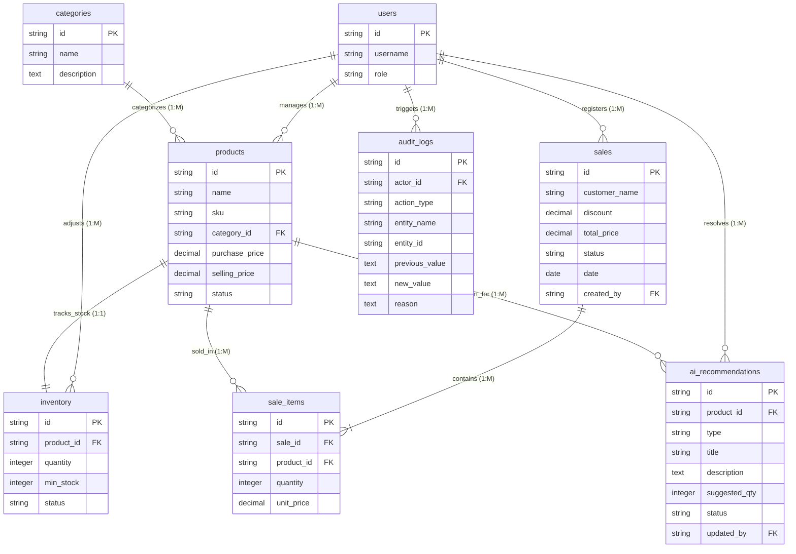

# StockWise — Entity-Relationship (ER) Diagram

This document presents the logical Entity-Relationship (ER) model for the StockWise application. It visualizes the tables, connections, keys, optionality, and cardinalities of the MVP database schema conceptually, without writing SQL scripts or physical implementation definitions.

---

## 1. Visual Entity-Relationship Diagram

The ER diagram below is rendered using Mermaid notation. It represents the logical entities, keys, and conceptual connections:

---

## 2. ER Diagram Legend

This legend defines the notation and symbols used in the visual model above:

* **PK**: Primary Key. A column (or set of columns) that uniquely identifies a record in the table.
* **FK**: Foreign Key. A column that references the primary key of another table to establish a logical link.
* **`||--||`**: One-to-One Mandatory Relationship. A record in the parent table must have exactly one corresponding record in the child table.
* **`||--o{`**: One-to-Many Optional Relationship. A parent record can be associated with zero, one, or many child records.
* **`||--|{`**: One-to-Many Mandatory Relationship. A parent record must be associated with one or more child records.
* **Line endpoints**:
  * **Mandatory (Solid double bar `||`)**: Indicates that the entity on this side must exist for the relationship to be valid.
  * **Optional (Circle and crow's foot `o{`)**: Indicates that the relationship on this side can have zero instances.
  * **Many (Crow's foot `{`)**: Indicates that there can be multiple associated instances.

---

## 3. Table Reference Cards

The following reference cards list keys and connections for each table:

### 3.1 products
* **Table Name**: `products`
* **Primary Key**: `id`
* **Foreign Keys**: `category_id` (references `categories`), `created_by` (references `users`), `updated_by` (references `users`)
* **Number of Relationships**: 5
* **Connected Tables**: `categories`, `inventory`, `sale_items`, `ai_recommendations`, `users`

### 3.2 categories
* **Table Name**: `categories`
* **Primary Key**: `id`
* **Foreign Keys**: None
* **Number of Relationships**: 1
* **Connected Tables**: `products`

### 3.3 inventory
* **Table Name**: `inventory`
* **Primary Key**: `id`
* **Foreign Keys**: `product_id` (references `products`), `updated_by` (references `users`)
* **Number of Relationships**: 2
* **Connected Tables**: `products`, `users`

### 3.4 sales
* **Table Name**: `sales`
* **Primary Key**: `id`
* **Foreign Keys**: `created_by` (references `users`)
* **Number of Relationships**: 2
* **Connected Tables**: `sale_items`, `users`

### 3.5 sale_items
* **Table Name**: `sale_items`
* **Primary Key**: `id`
* **Foreign Keys**: `sale_id` (references `sales`), `product_id` (references `products`)
* **Number of Relationships**: 2
* **Connected Tables**: `sales`, `products`

### 3.6 ai_recommendations
* **Table Name**: `ai_recommendations`
* **Primary Key**: `id`
* **Foreign Keys**: `product_id` (references `products`), `updated_by` (references `users`)
* **Number of Relationships**: 2
* **Connected Tables**: `products`, `users`

### 3.7 audit_logs
* **Table Name**: `audit_logs`
* **Primary Key**: `id`
* **Foreign Keys**: `actor_id` (references `users`)
* **Number of Relationships**: 1
* **Connected Tables**: `users`

### 3.8 users
* **Table Name**: `users`
* **Primary Key**: `id`
* **Foreign Keys**: None
* **Number of Relationships**: 6
* **Connected Tables**: `sales`, `audit_logs`, `products`, `inventory`, `ai_recommendations`

---

## 4. Relationship Explanations

We document the cardinalities and business meaning for each active relationship:

### 4.1 Category ➔ Products
* **Direction**: `categories` (Parent) ➔ `products` (Child)
* **Cardinality**: One Category to Many Products (`1:M`)
* **Business Meaning**: A category groups multiple products. Every product must be assigned to exactly one category, while a category can exist containing zero products.
* **Delete Behavior**: `Restrict` (cannot delete category with active products).
* **Update Behavior**: `Cascade` (updates to category ID sync automatically).

### 4.2 Product ➔ Inventory
* **Direction**: `products` (Parent) ➔ `inventory` (Child)
* **Cardinality**: One Product to One Inventory (`1:1`)
* **Business Meaning**: Every product has exactly one inventory count log tracking its physical quantity. Inventory records cannot exist without their corresponding product profile.
* **Delete Behavior**: `Restrict` (or logical soft-delete).
* **Update Behavior**: `Cascade`.

### 4.3 Sale ➔ Sale Items
* **Direction**: `sales` (Parent) ➔ `sale_items` (Child)
* **Cardinality**: One Sale to Many Sale Items (`1:M`)
* **Business Meaning**: A sale checkout transaction contains one or more itemized product purchase lines. A line item cannot exist without a referencing parent invoice.
* **Delete Behavior**: `Cascade` (cancelling/deleting a sale transaction cleans up all associated items).
* **Update Behavior**: `Cascade`.

### 4.4 Product ➔ Sale Items
* **Direction**: `products` (Parent) ➔ `sale_items` (Child)
* **Cardinality**: One Product to Many Sale Items (`1:M`)
* **Business Meaning**: A product can be sold multiple times, generating multiple transaction lines. A product cannot be deleted if historical sale records exist.
* **Delete Behavior**: `Restrict`.
* **Update Behavior**: `Cascade`.

### 4.5 Product ➔ AI Recommendations
* **Direction**: `products` (Parent) ➔ `ai_recommendations` (Child)
* **Cardinality**: One Product to Many AI Recommendations (`1:M`)
* **Business Meaning**: A product can have zero or more restock or audit recommendations generated. Recommendations are deleted if the product is retired.
* **Delete Behavior**: `Cascade`.
* **Update Behavior**: `Cascade`.

### 4.6 User ➔ Audit Logs
* **Direction**: `users` (Parent) ➔ `audit_logs` (Child)
* **Cardinality**: One User to Many Audit Logs (`1:M`)
* **Business Meaning**: Tracks which system operator triggered each event log.
* **Delete Behavior**: `Restrict`.
* **Update Behavior**: `Cascade`.

---

## 5. Integrity Validation

The logical validation parameters below guarantee data consistency:
* **Foreign Key References**: Every foreign key column in the logical schema matches and references an existing primary key of the target parent table.
  * `products.category_id` references `categories.id`
  * `inventory.product_id` references `products.id`
  * `sale_items.sale_id` references `sales.id`
  * `sale_items.product_id` references `products.id`
  * `ai_recommendations.product_id` references `products.id`
  * `sales.created_by` references `users.id`
  * `audit_logs.actor_id` references `users.id`
* **No Orphan Records**: Prevented by setting mandatory parent foreign keys and strict delete rules (`Restrict` on products and category removals).
* **Reachability**: Every table in the model is reachable through valid logical connections. There are no isolated "island" tables.
* **Direction Alignment**: Relationship directions and dependencies match the definitions in `04_Relationship_Analysis.md`.

---

## 6. Diagram Consistency Checklist

The validation matrix below confirms design consistency:

* `[x]` Matches **01_Business_Domain_Analysis.md** (All workflows and actors accounted for).
* `[x]` Matches **02_Entity_Analysis.md** (Includes all core identified MVP entities: Product, Category, Inventory, Sale, Sale Item, Recommendation, Audit Log, User).
* `[x]` Matches **03_Database_Schema.md** (Reflects the logical columns and table keys).
* `[x]` Matches **04_Relationship_Analysis.md** (Aligns with cardinality, participation, delete rules, and update rules).
* `[x]` No new entities or relationships were introduced during diagram creation.

---

## 7. Diagram Assumptions

* **UUID Primary Keys**: All primary keys are assumed to be unique strings (UUIDs) for global consistency.
* **Soft Delete Fields Omitted**: Fields like `deleted_at` are omitted from the visual Mermaid diagram block for readability, although they are defined in `03_Database_Schema.md`.
* **Future Entities Excluded**: Roadmap support entities (e.g. barcode scanner tags, variants, purchase orders, multiple warehouses) are excluded from this MVP diagram to focus on the primary domain structure.
